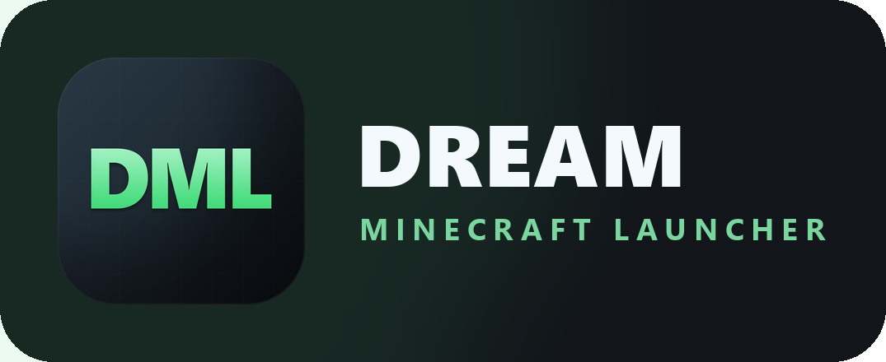
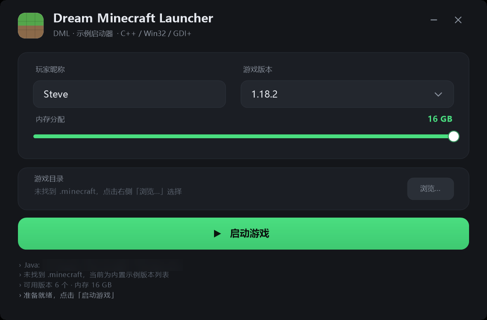
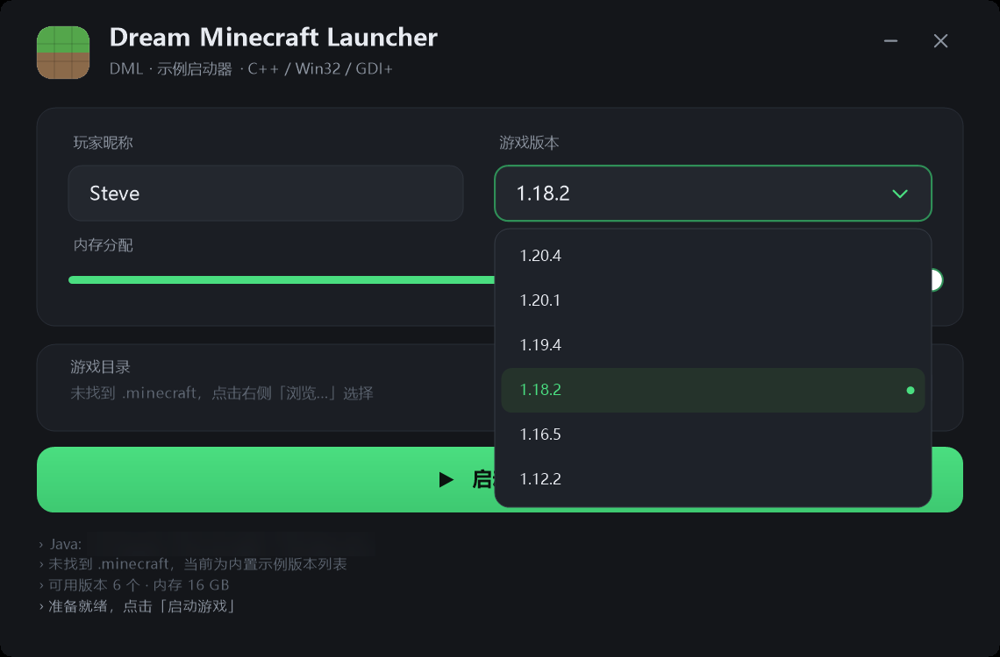
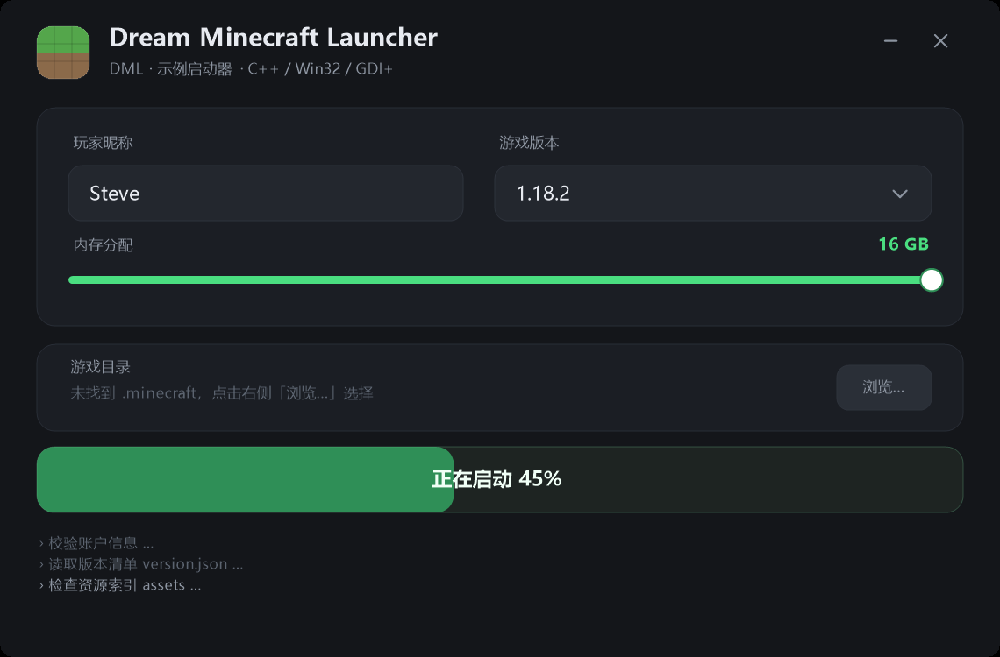
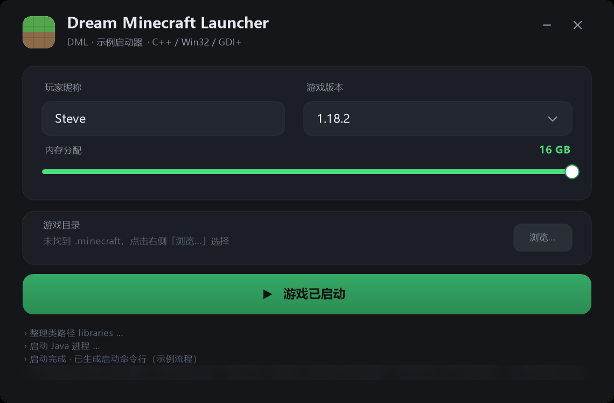

# Dream Minecraft Launcher (DML) —— 极简 Minecraft 启动器示例（C++）

<p align="center">
  
</p>

一个**纯 C++ / Win32 / GDI+** 编写的 Minecraft 启动器样本程序：无第三方 UI 库、无运行时依赖，
编译产物只有一个 exe。界面为深色、无边框圆角窗口，所有控件（输入框、下拉框、滑块、按钮、
日志面板）均为手工绘制，可直接作为二次开发的骨架。

```
┌──────────────────────────────────────────────────────────────┐
│ ▉ Dream Minecraft Launcher                       ─    ✕      │
│   DML · 示例启动器 · C++ / Win32 / GDI+                      │
│ ┌──────────────────────────────────────────────────────────┐ │
│ │ 玩家昵称              游戏版本                            │ │
│ │ ┌──────────────┐     ┌────────────────────┐              │ │
│ │ │ Steve        │     │ 1.20.4          ▾ │              │ │
│ │ └──────────────┘     └────────────────────┘              │ │
│ │ 内存分配                                           4 GB   │ │
│ │ ●──────────────────────────────────────────────          │ │
│ └──────────────────────────────────────────────────────────┘ │
│ ┌──────────────────────────────────────────────────────────┐ │
│ │ 游戏目录                                                  │ │
│ │ C:\Users\xxx\AppData\Roaming\.minecraft     [ 浏览… ]     │ │
│ └──────────────────────────────────────────────────────────┘ │
│ ┌──────────────────────────────────────────────────────────┐ │
│ │                  ▶  启 动 游 戏                           │ │
│ └──────────────────────────────────────────────────────────┘ │
│ › Java: C:\Program Files\Java\jdk-17\bin\java.exe            │
│ › 游戏目录: ...\.minecraft                                   │
│ › 准备就绪，点击「启动游戏」                                  │
└──────────────────────────────────────────────────────────────┘
```

## 界面预览

| 主界面 | 版本下拉 |
|---|---|
|  |  |

| 启动进度 | 启动完成 |
|---|---|
|  |  |

## 品牌资源

标志取 **Dream Minecraft Launcher** 的缩写 **DML**，圆角应用方块 + 粗体字母组合 + 渐变，
配色跟随应用主题（深色底 / 草绿 `#4ADE80`）。

| 文件 | 用途 |
|---|---|
| `assets/logo/dml-logo-1024.png` | 主图标，1024×1024，圆角外透明 |
| `assets/logo/dml-logo-512.png` / `-256.png` | 常用尺寸 |
| `assets/logo/dml.ico` | Windows 多尺寸图标（16–256） |
| `assets/logo/dml-lockup.png` | 横版标志（图标 + 字标），深色底板，浅色背景下同样可读 |
| `assets/logo/generate.py` | 生成脚本，改配色/字距后重跑即可复现全部产物 |

如需换配色，只改 `generate.py` 顶部的 `GREEN` / `GREEN_LO` / `BG_A` / `BG_B` 四个常量，
再执行 `python assets/logo/generate.py`。

## 目录结构

```
MCLaucher/
├─ src/main.cpp        # 全部源码（约 900 行，单文件）
├─ build.bat           # 一键编译：自动挑选 MSVC / MinGW / Zig
├─ CMakeLists.txt      # 可选，CMake 构建
├─ build/DML.exe    # 编译产物
├─ docs/               # 界面截图
└─ README.md
```

## 编译

### 方式一：一键脚本（推荐）

```bat
build.bat
```

脚本会依次尝试 **MSVC（VS2019/2022 含 C++ 工作负载）→ MinGW g++ → Zig**，产物在 `build\DML.exe`。

发布用的构建默认带 `-s`（剥离符号），避免可执行文件里嵌入本机绝对路径与调试信息；
`build\` 目录已加入 `.gitignore`，调试符号（`.pdb`）不要随发行包一起分发。

若三者都不在 PATH 中，脚本还会尝试本机已缓存的 zig 工具链（具体路径见 `build.bat` 第 3 步），
无需额外安装 Visual Studio 或 Windows SDK。

### 方式二：MSVC（开发者命令提示符）

```bat
cl /nologo /std:c++17 /EHsc /O2 /MT /DUNICODE /D_UNICODE src\main.cpp ^
   /Fe:build\DML.exe /link /SUBSYSTEM:WINDOWS gdiplus.lib shell32.lib ole32.lib
```

### 方式三：MinGW-w64

```bat
g++ -std=c++17 -O2 -mwindows -DUNICODE -D_UNICODE src\main.cpp -o build\DML.exe ^
    -lgdiplus -lshell32 -lole32 -lgdi32 -luser32 -static-libgcc -static-libstdc++
```

### 方式四：CMake

```bat
cmake -B out -A x64
cmake --build out --config Release
```

## 已实现的功能

| 模块 | 说明 |
|---|---|
| 无边框窗口 | `WS_POPUP` + `CreateRoundRectRgn` 圆角；顶部空白区拖动，自绘最小化/关闭按钮 |
| 双缓冲绘制 | 内存 DC + `BitBlt`，`Graphics` 抗锯齿，窗口缩放/重绘不闪烁 |
| 自绘输入框 | 光标闪烁（`WM_CHAR` / 定时器）、退格、16 字符上限、聚焦高亮描边 |
| 自绘下拉框 | 浮层绘制在主窗口之上、悬停高亮、滚轮翻页（>6 个版本时） |
| 内存滑块 | 1–16 GB 拖动调节，按下即跟随鼠标并捕获输入 |
| 环境探测 | 扫描 `.minecraft\versions\*\*.json` 得到真实版本列表；`JAVA_HOME` 与常见安装目录探测 Java |
| 目录选择 | `SHBrowseForFolder` 选择游戏目录，切换后自动重扫版本 |
| 配置持久化 | 退出/修改时写入 `%APPDATA%\DreamMinecraftLauncher\config.ini`（UTF-8） |
| 启动流程 | 5 步进度模拟（0→100%），按钮内进度条动画，完成后输出真实命令行到日志 |
| DPI 适配 | `SetProcessDPIAware` + 全局缩放系数，1080P / 4K 下布局一致 |

## 快捷键

- `Enter` 启动游戏
- `Esc` 关闭版本下拉浮层
- 光标在昵称框内时可正常输入 / 退格

## 代码导读（`src/main.cpp`）

```
Theme           配色常量
S() / SR()      DPI 缩放换算
AddRoundRect    圆角矩形路径（FillRound / StrokeRound）
DrawStr         带对齐与省略号的文字绘制
ComputeLayout   全部控件坐标集中在此，改界面只改这一个函数
AppState        全局状态（昵称、版本、内存、hover、下拉、启动进度）
ScanVersions    扫描 .minecraft\versions
DetectJava      探测 java.exe
BuildLaunchCommand  拼装完整启动命令行
Paint           绘制入口（先背景 → 卡片 → 控件 → 浮层）
WndProc         消息处理：绘制 / 命中测试 / 输入 / 拖动
```

## 接入真实启动

当前 `StartLaunch()` 只做进度模拟，不会真正拉起游戏。真实启动需要补齐：

1. **鉴权**：微软 OAuth 设备码流程，或离线登录（`--uuid` / `--accessToken` 用占位值）。
2. **版本清单**：解析 `versions\<v>\<v>.json` 的 `inheritsFrom` 继承链，合并 libraries。
3. **补全资源**：下载缺失的 `libraries`、校验 `assets` 索引、解压 `natives`。可用 [libcurl] 或 WinHTTP。
4. **启动进程**：把 `BuildLaunchCommand()` 的结果交给 `CreateProcessW`（源码中已给出示例片段）。

建议把上述逻辑拆成独立的 `Launcher` 类，保持 UI 层只负责展示与交互。

## 已知限制

- 启动流程为演示实现，不下载资源、不登录。
- 无边框窗口不支持拖拽缩放（启动器一般也不需要）。
- 版本列表只认 `versions\*\*.json` 存在的目录，未安装任何版本时回退到内置示例列表。

## 许可证

本项目基于 [MIT License](LICENSE) 开源。

```
Copyright (c) 2026 Dadi
```

二次开发时如需替换署名，修改 `LICENSE` 首行即可。
