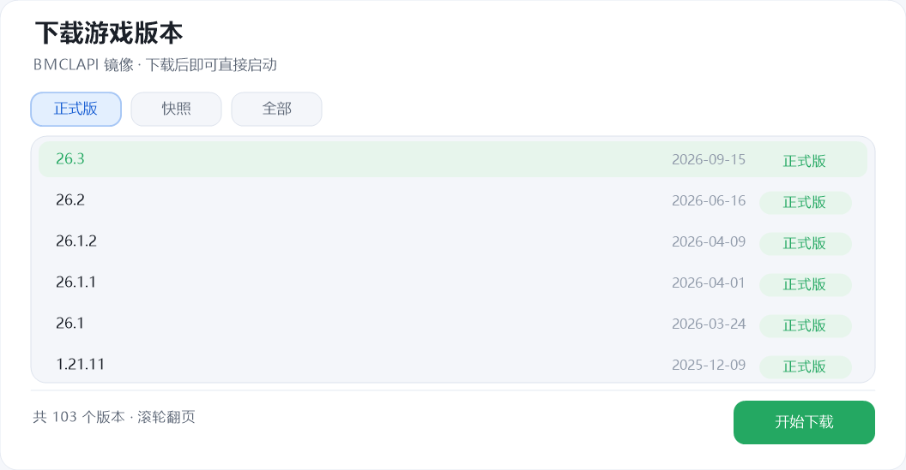
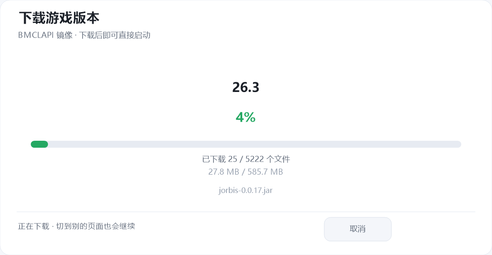

# Dream Minecraft Launcher (DML) —— 极简 Minecraft 启动器（C++）

<p align="center">
  
</p>

一个**纯 C++ / Win32 / GDI+** 编写的 Minecraft 启动器：无第三方 UI 库、无运行时依赖，
编译产物只有一个 exe。界面为**浅色**（白底 + 浅蓝账号胶囊 + 草绿强调）、无边框圆角窗口，
所有控件（输入框、下拉框、滑块、按钮、日志面板）均为手工绘制。标题下方分三个标签页：
**开始 / 下载 / 设置**。

它**能真的把游戏启动起来**：自己解析 `version.json`（含 `inheritsFrom` 继承与 `rules` 过滤）、
拼出完整 `java` 命令行、拉起进程并把游戏输出回灌到界面日志。账号支持**离线**与
**微软账号（设备码授权）**两种模式，默认离线；**没装的版本也能直接在启动器里下载**——
走 BMCLAPI 镜像，一次把版本 JSON、客户端 jar、依赖库与全部资源对象拉全，下完即可启动
（详见[真实启动](#真实启动)与[下载版本](#下载版本)）。

```
┌──────────────────────────────────────────────────────────────┐
│ ▉ Dream Minecraft Launcher                       ─    ✕      │
│   开始    下载    设置                                       │
│ ┌──────────────────────────────────────────────────────────┐ │
│ │ 玩家昵称              游戏版本                           │ │
│ │ ┌──────────────┐     ┌────────────────────┐              │ │
│ │ │ Steve        │     │ 1.20.4          ▾ │               │ │
│ │ └──────────────┘     └────────────────────┘              │ │
│ │ (离线登录) (微软登录)                                    │ │
│ └──────────────────────────────────────────────────────────┘ │
│ ┌──────────────────────────────────────────────────────────┐ │
│ │                  ▶  启 动 游 戏                          │ │
│ └──────────────────────────────────────────────────────────┘ │
│ ┌──────────────────────────────────────────────────────────┐ │
│ │ › Java: C:\Program Files\Java\jdk-17\bin\java.exe        │ │
│ │ › 游戏目录: ...\.minecraft                               │ │
│ │ › 准备就绪，点击「启动游戏」                             │ │
│ └──────────────────────────────────────────────────────────┘ │
└──────────────────────────────────────────────────────────────┘
```

三个标签页各管一摊：

| 标签 | 内容 |
|---|---|
| **开始** | 玩家昵称、离线 / 微软登录、游戏版本、启动按钮、运行日志 |
| **下载** | 从 BMCLAPI 镜像下载任意正式版 / 快照（详见[下载版本](#下载版本)） |
| **设置** | 游戏目录、Java 路径、内存分配、附加 JVM 参数、关于 |

## 界面预览

| 开始页 | 版本下拉 |
|---|---|
|  |  |

| 启动进度 | 启动完成 |
|---|---|
|  |  |

| 下载版本 | 下载进度 |
|---|---|
|  |  |

> 截图中的日志首行（Java 路径）已做马赛克处理，避免暴露本机目录结构。

## 品牌资源

标志取 **Dream Minecraft Launcher** 的缩写 **DML**，圆角应用方块 + 粗体字母组合 + 渐变。
标志自身是深色底 + 草绿渐变字，放在浅色界面里作为对比鲜明的应用图标。

| 文件 | 用途 |
|---|---|
| `assets/logo/dml-logo-1024.png` | 主图标，1024×1024，圆角外透明 |
| `assets/logo/dml-logo-512.png` / `-256.png` | 常用尺寸 |
| `assets/logo/dml.ico` | Windows 多尺寸图标（16–256） |
| `assets/logo/dml-lockup.png` | 横版标志（图标 + 字标），深色底板，浅色背景下同样可读 |
| `assets/logo/generate.py` | 生成脚本，改配色/字距后重跑即可复现全部产物 |

如需换配色，只改 `generate.py` 顶部的 `GREEN` / `GREEN_LO` / `BG_A` / `BG_B` 四个常量，
再执行 `python assets/logo/generate.py`。

**图标已编入 exe**：`res/app.rc` 把 `dml.ico` 注册为 `RT_GROUP_ICON`（ID 101）、把
`dml-logo-256.png` 原样嵌为 `RT_RCDATA`（ID 201），两者 ID 定义在 `src/resource.h`。
运行时 `LoadImageW` 取窗口/任务栏图标，`LoadLogoResource()` 经 `CreateStreamOnHGlobal`
把 PNG 交给 GDI+ 解码并画到页眉；资源缺失时自动回退到旧的「手绘草方块」。

## 目录结构

```
MCLaucher/
├─ src/main.cpp        # 全部源码（约 3670 行，单文件）
├─ src/resource.h      # 资源 ID（app.rc 与 main.cpp 共用）
├─ res/app.rc          # 资源脚本：图标 + 页眉标志
├─ assets/logo/        # 标志源文件与生成脚本
├─ build.bat           # 一键编译：自动挑选 MSVC / MinGW / Zig
├─ CMakeLists.txt      # 可选，CMake 构建
├─ build/DML.exe       # 编译产物
├─ docs/               # 界面截图
└─ README.md
```

## 编译

### 方式一：一键脚本（推荐）

```bat
build.bat
```

脚本会依次尝试 **MSVC（VS2019/2022 含 C++ 工作负载）→ MinGW g++ → Zig**，产物在 `build\DML.exe`。
前两者会先用 `rc.exe` / `windres` 编译 `res\app.rc`，把图标与页眉标志一并链接进 exe；
Zig 没有资源编译器，走这条路时产物不带图标（功能不受影响，会自动回退手绘标志）。

发布用的构建默认带 `-s`（剥离符号），避免可执行文件里嵌入本机绝对路径与调试信息；
`build\` 目录已加入 `.gitignore`，调试符号（`.pdb`）不要随发行包一起分发。

若三者都不在 PATH 中，脚本还会尝试本机已缓存的 zig 工具链（具体路径见 `build.bat` 第 3 步），
无需额外安装 Visual Studio 或 Windows SDK。

> 踩坑记录：`windres` 内部调用 `gcc` 时不加引号，MinGW 装在含空格的路径（如
> `C:\Program Files\...`）下会直接报 `preprocessing failed`。`build.bat` 里会在
> `build\tc` 建一个目录联接（`mklink /J`）指向工具链根目录，用无空格路径调用；另外
> `cc1.exe` 依赖 `libwinpthread-1.dll`，必须把 `<mingw>\bin` 加进 `PATH`，否则报的是
> 无任何提示的 `exit 1`（实际退出码 `0xC0000135` = STATUS_DLL_NOT_FOUND）。

### 方式二：MSVC（开发者命令提示符）

```bat
rc /nologo /fo build\app.res res\app.rc
cl /nologo /std:c++17 /EHsc /O2 /MT /DUNICODE /D_UNICODE src\main.cpp build\app.res ^
   /Fe:build\DML.exe /link /SUBSYSTEM:WINDOWS gdiplus.lib shell32.lib ole32.lib
```

### 方式三：MinGW-w64

```bat
windres res\app.rc -O coff -o build\app.res.o
g++ -std=c++17 -O2 -mwindows -DUNICODE -D_UNICODE src\main.cpp build\app.res.o ^
    -o build\DML.exe -lgdiplus -lshell32 -lole32 -lgdi32 -luser32 -static -s
```

### 方式四：CMake

```bat
cmake -B out -A x64
cmake --build out --config Release
```

## 已实现的功能

| 模块 | 说明 |
|---|---|
| 标签页 | 标题下方「开始 / 下载 / 设置」三个标签，绿色下划线指示当前页；三个页面共用同一套自绘控件，切页不重建窗口 |
| 无边框窗口 | `WS_POPUP` + `CreateRoundRectRgn` 圆角；顶部空白区拖动，自绘最小化/关闭按钮 |
| 双缓冲绘制 | 内存 DC + `BitBlt`，`Graphics` 抗锯齿，窗口缩放/重绘不闪烁 |
| 品牌资源 | 图标与页眉标志编进 exe（`res/app.rc`）；窗口、任务栏图标取自多尺寸 `dml.ico`，页眉用 GDI+ 高质量缩放绘制 PNG 标志 |
| 自绘输入框 | 光标闪烁（`WM_CHAR` / 定时器）、退格、16 字符上限、聚焦高亮描边 |
| 自绘下拉框 | 浮层绘制在主窗口之上、悬停高亮、滚轮翻页（>6 个版本时） |
| 内存滑块 | 1–16 GB 拖动调节，按下即跟随鼠标并捕获输入 |
| 附加 JVM 参数 | 设置页可填任意 JVM 参数（如 `-XX:+UseG1GC -Dfile.encoding=UTF-8`），**原样**拼在 `-Xmx/-Xms` 之后、版本自带 JVM 参数之前；存进 `config.ini` 的 `jvmargs=` |
| 环境探测 | 扫描 `.minecraft\versions\*\*.json` 得到真实版本列表；`JAVA_HOME` 与常见安装目录探测 Java |
| 目录选择 | `SHBrowseForFolder` 选择游戏目录，切换后自动重扫版本 |
| 版本下载 | 「下载」标签页，数据取自 **BMCLAPI 镜像**：版本清单 → 版本 JSON → 客户端 jar → 依赖库（含 windows 分类器）→ 资源索引 → 全部资源对象，下完直接出现在版本下拉里 |
| 并发与续传 | 16 路并发拉小文件；按字节数校验完整性，目标文件已存在且大小正确就跳过，中断后重按即续传 |
| 下载页 | 正式版 / 快照 / 全部三档筛选、滚轮翻页、↑↓ 选择、回车即下；进度页显示百分比、文件数、字节数与当前文件 |
| 账号登录 | 昵称框下方「离线登录 / 微软登录」两个胶囊（默认离线）；微软走设备码授权 → XBL → XSTS → Minecraft Services，成功后用**正版游戏 ID** 覆盖昵称，启动时注入真实 `accessToken` / `uuid` / `xuid` |
| 令牌安全 | refresh token 经 DPAPI（`CryptProtectData`）加密后落盘，下次启动静默续期；access token 只留在内存 |
| 验证码弹窗 | 码就绪即复制到剪贴板并弹出卡片（160ms ease-out 动画），倒计时 5 秒后自动唤起浏览器，点「重新打开浏览器」可立即打开 |
| 浅色主题 | 白底深字 + 浅蓝账号胶囊 + 草绿强调，配色集中在 `Theme` 命名空间，改一处即可整体换肤 |
| 配置持久化 | 退出/修改时写入 `%APPDATA%\DreamMinecraftLauncher\config.ini`（UTF-8），含 `username` / `version` / `memory` / `gamedir` / `java` / `jvmargs` |
| 启动流程 | 5 个真实步骤（校验账户 → 读版本清单 → 查依赖 → 整理参数 → 拉起 Java），按钮内进度条 16ms 一帧平滑推进 |
| 版本清单解析 | 自带极简 JSON 解析器；支持 `inheritsFrom` 继承链合并、`rules` 的 `os.name` / `os.arch` / `features` 过滤 |
| 类路径与 natives | 按 maven 坐标还原 jar 路径，同 `group:artifact` 去重（子版本覆盖父版本）；natives jar 一并加入 `classpath`（LWJGL3 会自行从 jar 内解压原生库） |
| 占位符替换 | `${auth_player_name}` `${version_name}` `${game_directory}` `${assets_index_name}` `${classpath}` 等全套替换，未知占位符清空 |
| 进程拉起 | `CreateProcessW` 启动 `java`，stdout/stderr 通过管道回灌到日志面板（UTF-8 / GBK 自动判别），并检测进程退出码 |
| DPI 适配 | `SetProcessDPIAware` + 全局缩放系数，1080P / 4K 下布局一致 |

## 快捷键

- `Enter` 启动游戏（下载页内 = 开始下载）
- `Esc` 关闭版本下拉浮层 / 验证码弹窗；在下载页按 `Esc` 回到「开始」
- 在昵称框或「附加 JVM 参数」里打字时，`Enter` / `Esc` 只收起焦点，不会触发启动
- 下载页可用 `↑` `↓` 选择版本、滚轮翻页
- 光标在昵称框内时可正常输入 / 退格

## 代码导读（`src/main.cpp`）

```
Theme           配色常量
S() / SR()      DPI 缩放换算
AddRoundRect    圆角矩形路径（FillRound / StrokeRound）
DrawStr         带对齐与省略号的文字绘制
DrawLogo        页眉标志（内嵌 PNG 优先，缺失时回退手绘草方块）
LoadLogoResource  从 RT_RCDATA 取出 PNG → IStream → GDI+ Image
ComputeLayout   全部控件坐标集中在此，改界面只改这一个函数
DrawTabs        标题下方的「开始 / 下载 / 设置」标签
DrawStartPage   开始页：昵称 / 账号 / 版本 / 启动按钮 / 日志
DrawSettingsPage 设置页：游戏目录 / Java 路径 / 内存滑块 / 关于
ChooseJava      弹出文件对话框指定 java.exe（写回 config.ini）
SwitchPage      切页（首次进下载页时去拉版本清单）
AppState        全局状态（昵称、版本、内存、hover、下拉、启动进度）
ScanVersions    扫描 .minecraft\versions
DetectJava      探测 java.exe
--- 版本清单与启动 ---
JVal / JsonParser   极简 JSON 解析器（够 version.json 用）
RulesAllow      按 os / features 过滤 libraries 与启动参数
MavenRel        group:artifact:version[:classifier] → 相对 jar 路径
ResolveVersion  解析继承链、合并 libraries、替换占位符、拼出完整命令行
OfflineUuid     由昵称派生稳定 UUID
SpawnGame       CreateProcessW 拉起 java，管道回灌输出
PipeReader      子进程 stdout/stderr → WM_APP_LOG（UTF-8/GBK 自动判别）
LaunchTick      启动状态机单步：跑当前步骤 / 进度满则推进下一步
--- 微软账号 ---
HttpsPost       WinHTTP 手写 POST（取设备码 / 换令牌链）
MsLoginThread   设备码授权 → XBL → XSTS → Minecraft Services → 档案
MsRefreshThread 用 DPAPI 解出来的 refresh token 静默续期
DrawAuthPill    昵称框下方「离线登录 / 微软登录」浅蓝胶囊
DrawMsDialog    验证码弹窗（scrim + 卡片滑入，ease-out 动画）
--- 下载版本 ---
DlManifestThread 拉取 BMCLAPI 版本清单（920+ 个版本）
BuildDlPlan     版本 JSON + 客户端 jar + 依赖库 + 资源索引 + 资源对象，去重成任务表
HttpDownload    流式下载到 .part → 原子改名，按 size 校验
DlWorker        16 路并发工作线程：原子取任务、跳过已存在文件、累计字节
DlThread        单个版本的下载总控（建计划 → 线程池 → 汇报 UI）
DrawDlPage      下载页：筛选列表 / 进度面板 / 完成与失败
Paint           绘制入口（背景 → 标签页 → 当前页 → 浮层 → 弹窗）
WndProc         消息处理：绘制 / 命中测试 / 输入 / 拖动 / 启动进度
```

## 真实启动

点击「启动游戏」后会真的把游戏拉起来，不再只是进度动画。流程分 5 步，每步都做实事：

| 步骤 | 实际动作 |
|---|---|
| 校验账户信息 | 检查 Java 是否可用；离线模式派生稳定 UUID，微软账号注入真实 `accessToken` / `uuid` / `xuid` |
| 读取版本清单 | 解析 `versions\<v>\<v>.json`，沿 `inheritsFrom` 合并继承链 |
| 检查依赖文件 | 逐个校验 `libraries` / 客户端 jar 是否存在，缺失就中止并列出首个缺失路径 |
| 整理类路径与参数 | 拼 `-cp`、替换全部占位符，逐参数转义 |
| 启动 Java 进程 | `CreateProcessW` 拉起，管道读回 stdout/stderr 显示在日志区 |

成功拉起后，最终命令行会写到 `%APPDATA%\DreamMinecraftLauncher\last-command.txt`，方便排查启动失败。

账号模式由昵称框下方的两个胶囊决定，进入即默认**离线登录**：

- **离线登录**：`--accessToken` 用占位值 `0`，`--uuid` 由昵称经 FNV-1a 派生，只能玩单人 / 离线服。
- **微软登录**：设备码授权拿 refresh token（DPAPI 加密后存 `account.dat`），再走
  XBL → XSTS → Minecraft Services 换出真实 access token；登录成功后昵称框显示**正版游戏 ID**
  （不再额外展示 UUID），启动时注入真实的 `accessToken` / `uuid` / `xuid`，可进正版服务器。

还没做的（见下方「已知限制」）：

1. **资源补全**：启动时不会自动补齐缺失依赖；要补请到「下载」页装整版（见下节）。
2. **natives 解压**：不自己解压 natives jar，而是把 natives jar 加进 `classpath`，
   由 LWJGL3 在加载时自行从 jar 内提取原生库。这套做法对 1.13+ 有效；
   更老的 LWJGL2 版本仍需真实解压到 `versions\<v>\natives`。

建议把上述逻辑拆成独立的 `Launcher` 类，保持 UI 层只负责展示与交互。

## 下载版本

标题下方的第二个标签就是「下载」页，切过去即是版本列表：

- **筛选**：正式版 / 快照 / 全部，默认正式版（约 103 个）
- **选择**：滚轮翻页、`↑` `↓` 移动、单击选中；再点一次该行（或回车 /「开始下载」）开跑
- **下载**：按下面的顺序拉，进度页显示百分比、文件数、字节数与当前文件

| 顺序 | 内容 | 落点 |
|---|---|---|
| 1 | 版本 JSON | `.minecraft\versions\<id>\<id>.json` |
| 2 | 客户端 jar | `.minecraft\versions\<id>\<id>.jar` |
| 3 | 依赖库（artifact + windows 分类器） | `.minecraft\libraries\...` |
| 4 | 资源索引 | `.minecraft\assets\indexes\<index>.json` |
| 5 | 资源对象 | `.minecraft\assets\objects\<h2>\<hash>` |

几个实现要点：

- 请求全部打到 `https://bmclapi2.bangbang93.com`。版本 JSON 里仍是 Mojang 官方 URL，
  由 `MirrorUrl()` 改写主机（`libraries.minecraft.net` → `/maven`、
  `resources.download.minecraft.net` → `/assets`）；客户端 jar 直接用 `/version/<id>/client`，
  不依赖 `piston-data` 的跳转。
- **16 路并发**：一个版本三四千个资源对象，串行下载会被单次往返延迟拖死，
  所以用线程池按原子计数器取任务。
- **断点续传**：每个文件先写 `<file>.part`，校验字节数后再 `MoveFileEx` 覆盖；
  目标文件已存在且大小正确就直接跳过，中断后重开只补缺的那部分。
- 下载完成会自动重扫版本列表、选中新版本并写回 `config.ini`。
- 下载中点「取消」只停工作线程，已下好的文件保留；切到别的标签页下载**照常继续**。

## 已知限制

- 启动时不会自动补全依赖与资源（请先到「下载」页把版本装全），也没有 assets 完整性校验。
- 微软账号只完成登录，不校验游戏所有权（跳过 `/entitlements`）。
- 版本没装全时不会自动补齐，只会提示缺多少个依赖文件（首个路径会显示在日志里）。
- 无边框窗口不支持拖拽缩放（启动器一般也不需要）。
- 版本列表只认 `versions\*\*.json` 存在的目录，未安装任何版本时回退到内置示例列表
  （此时点启动会报「缺少依赖文件」，属于预期行为）。

## 许可证

本项目基于 [MIT License](LICENSE) 开源。

```
Copyright (c) 2026 Dadi
```

